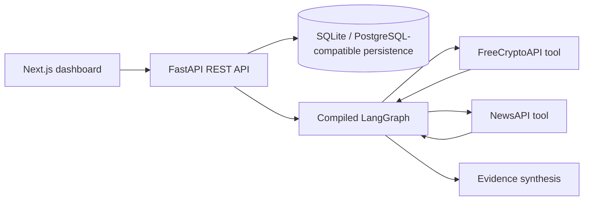

# Architecture

The application is split into a Next.js client and a FastAPI service. The client only receives public analytical output; credentials remain server-side.

The repository deliberately reports unavailable providers instead of substituting mock prices or articles.

The browser client communicates with `/api/dashboard`, `/api/chat`, `/api/conversations`, and `/api/health/providers`. Provider credentials remain backend-only. SQLAlchemy conversation persistence and LangGraph checkpoint persistence are separate concerns.
