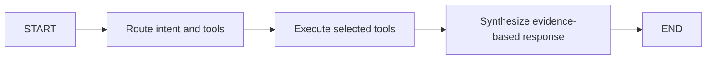

# LangGraph workflow

`AgentState` carries the question, prior conversation, selected tools, validated observations, activity summaries, evidence, and response. The LLM node uses `ChatOpenAI.with_structured_output(AnalysisResponse)` and receives only the validated evidence packet plus recent conversation context. If OpenAI is unavailable, the node returns an explicit unavailable status instead of guessing. The graph intentionally exposes concise activity summaries rather than private chain-of-thought.
